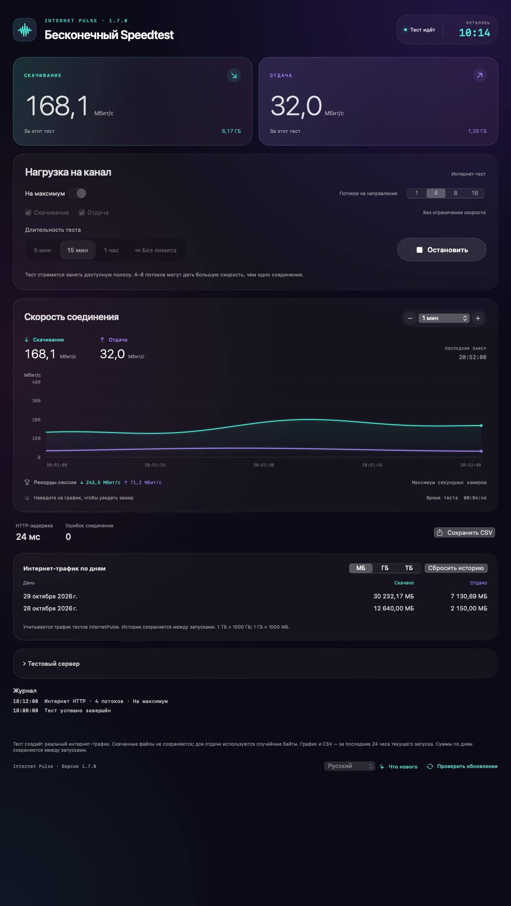
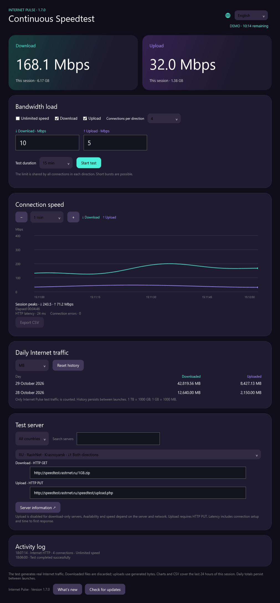

# Internet Pulse

**Бесконечный Speedtest для macOS и Windows 11.** Проверяйте, как интернет держит длительную нагрузку: выбирайте скорость скачивания и отдачи, включайте параллельные соединения и наблюдайте за графиком.

**Русский** · [English](docs/i18n/README.en.md) · [Français](docs/i18n/README.fr.md) · [Deutsch](docs/i18n/README.de.md) · [Español](docs/i18n/README.es.md)

**Версия 1.7.0 · MIT**  
macOS 14+ / Apple Silicon · Windows 11 / x64

*Изображения получены из интерфейса приложения с демонстрационными данными. Это не результаты измерений сети.*

Windows 11 — интерфейс приложения

## Зачем он нужен

Обычный спидтест показывает скорость за короткий замер. Internet Pulse создаёт нагрузку на несколько минут, час или без ограничения времени. Можно увидеть провалы скорости, сравнить Wi-Fi и кабель, проверить соединение в разных комнатах и вечером.

## Возможности

- Скачивание и отдача вместе или по отдельности; свои HTTP GET / PUT адреса.
- Режим максимальной скорости или отдельные лимиты 0,1–20 000 Мбит/с.
- 1, 4, 8 или 16 соединений на направление. Лимит делится между потоками.
- График от 30 секунд до 24 часов, значения при наведении, рекорды секундных замеров.
- Тесты на 5 минут, 15 минут, час или без лимита; обратный отсчёт либо таймер.
- История трафика по дням, МБ / ГБ / ТБ, разделители тысяч, сброс истории.
- История сохраняется раз в 10 секунд и при остановке/выходе. При аварийном завершении могут потеряться последние секунды.
- Каталог серверов по странам, поиск по названию; отметки «скачивание» и «оба направления».
- Журнал подключения, ошибок, повторов и результата теста; индикация отсутствия передачи данных.
- Экспорт CSV, история версий и ручная проверка обновлений через GitHub.
- Русский, английский, французский, немецкий и испанский языки.

## Скачать и запустить

Откройте [последний релиз](https://github.com/Ezhov777/InternetPulse/releases/latest) и выберите архив:

| Система | Архив | Запуск |
|---|---|---|
| macOS 14+, Apple Silicon | `InternetPulse-1.7.0-macos-arm64.zip` | Распакуйте, перенесите `InternetPulse.app` в «Программы» |
| Windows 11, x64 | `InternetPulse-1.7.0-win11-x64.zip` | Распакуйте всю папку и запустите `InternetPulse.exe` |

Перед заменой приложения закройте предыдущую версию. Готовым сборкам не нужны Xcode, Developer Tools, Visual Studio или отдельная установка .NET. Windows-архив содержит необходимые компоненты .NET; файлы из папки нужно хранить вместе.

Mac-сборка подписана локально (ad hoc), без Developer ID и нотариализации Apple. Windows-сборка не имеет подписи Authenticode. Системы могут предупредить о неизвестном издателе при первом запуске. Контрольные суммы доступны в релизе. Windows-интерфейс и движок проверяются автоматически на Windows CI; проверка на реальном пользовательском Windows 11 отдельно не выполнялась.

## Как пользоваться

Для максимальной скорости включите «На максимум» и начните с 4 потоков. Сравните 1 и 8: больше соединений не всегда быстрее. Ограничением могут быть сервер, провайдер, Wi-Fi или компьютер.

Для заданной нагрузки выключите этот режим и введите лимиты. **100 Мбит/с с 4 потоками — около 100 Мбит/с суммарно на направление**, а не 400. На коротких интервалах возможны всплески. График показывает Мбит/с по вертикали и время по горизонтали; 80 Мбит/с ≈ 10 МБ/с.

Объём трафика использует десятичные единицы: **1 ТБ = 1000 ГБ; 1 ГБ = 1000 МБ**. Формат чисел и дат зависит от языка. Язык меняется в меню с глобусом вверху справа.

## Данные и ограничения

Измеряется полезная HTTP-нагрузка приложения, а не весь системный трафик и не накладные расходы протоколов. Скачанные файлы не сохраняются; для отдачи используются генерируемые байты. HTTP-задержка включает установку соединения и время до первого ответа — это не ICMP-пинг и не оценка потерь пакетов.

Сервер получает запросы и видит IP соединения. Аналитики и передачи истории разработчику нет. Проверка обновлений обращается к публичному GitHub API только по команде пользователя; установка обновлений ручная. История и настройки хранятся локально. macOS сохраняет прежний идентификатор настроек для переноса истории; на Windows данные лежат в `%LOCALAPPDATA%\InternetPulse`.

Серверы принадлежат сторонним провайдерам. Их доступность и скорость могут меняться и отличаться между сетями; общий каталог не является гарантией пропускной способности. Серверы без совместимого HTTP PUT отмечены как «только скачивание», даже если их сайт предлагает другой тест отдачи.

## Разработка

Для исходников, скачанных с GitHub, сначала выполните `chmod +x build.sh scripts/*.sh`.

Mac: `./scripts/test.sh`, `./scripts/test-network.sh`, `./scripts/package.sh`. Нужны Apple Command Line Tools только на машине разработчика.

Windows: .NET 10 SDK; `dotnet run --project Windows.Tests -c Release`, затем `dotnet publish Windows -c Release -r win-x64 --self-contained true -o dist/windows`. CI также проверяет запуск WPF-окна.

[Порядок выпуска](docs/RELEASING.md) · [История изменений](CHANGELOG.md) · [Каталог серверов](servers.tsv) · [MIT](LICENSE)
