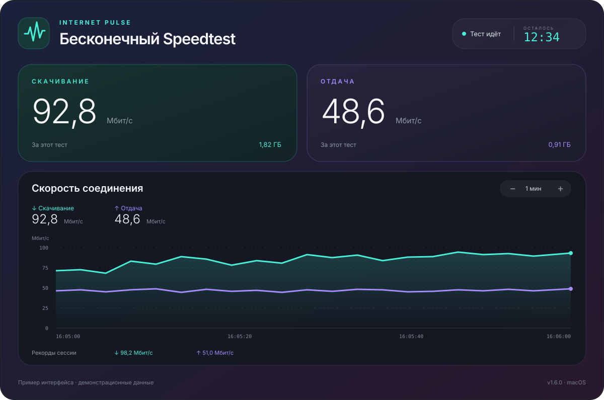

# Internet Pulse

**Бесконечный Speedtest.** Проверяйте, как интернет держит нагрузку: одновременно скачивайте и отправляйте тестовые данные, выбирайте скорость и следите за графиком.

[](https://github.com/Ezhov777/InternetPulse/releases/latest)

Native macOS app for continuous download/upload testing, configurable bandwidth limits, parallel connections, session peaks and daily traffic history.



**Версия:** 1.6.0 · **macOS:** 14+ · **Процессор:** Apple Silicon · **Лицензия:** MIT

## Зачем он нужен

Обычный спидтест показывает скорость за короткий замер. InternetPulse позволяет оставить нагрузку на несколько минут, час или без ограничения времени: увидеть провалы скорости, сравнить Wi-Fi и кабель, проверить разные места в квартире или работу соединения вечером.

## Возможности

- Скачивание и отдача одновременно или по отдельности.
- Режим «На максимум» и отдельные лимиты каждого направления: 0,1–20 000 Мбит/с.
- 1, 4, 8 или 16 соединений на направление. Лимит общий для выбранного направления.
- График с масштабом от 30 секунд до 24 часов и просмотром замеров при наведении.
- Рекорды скачивания и отдачи за сессию.
- Встроенная история изменений «Что нового» и ручная проверка обновлений GitHub.
- Тесты на 5 минут, 15 минут, час или без ограничения времени.
- Обратный отсчёт для ограниченного теста и таймер для непрерывного.
- История трафика по дням в МБ/ГБ, сохраняемая после закрытия приложения, и её сброс.
- Экспорт секундных измерений в CSV, журнал ошибок и повторное подключение.
- 12 предустановленных серверов, преимущественно в России, и свои HTTP-адреса.

## Скачать и запустить

1. Откройте **Releases** этого репозитория.
2. Скачайте `InternetPulse-1.6.0-macos-arm64.zip` и распакуйте его.
3. Перенесите `InternetPulse.app` в «Программы» и откройте.

Готовая сборка рассчитана на Mac с Apple Silicon и macOS 14 или новее. Intel Mac и Windows этой сборкой не поддерживаются. **Windows 11 — в планах**, готового Windows-приложения пока нет.

Сборка имеет локальную подпись ad hoc, без Developer ID и нотариализации Apple. На другом Mac Gatekeeper может заблокировать первый запуск. Сама подпись не требует обновления каждые несколько недель. Для широкого распространения предусмотрена дальнейшая подготовка Developer ID и нотариализации; сертификаты в репозитории не хранятся.

## Как пользоваться

Для проверки максимальной скорости включите «На максимум» и начните с 4 потоков. Сравните с 1 и 8 потоками. Большое число соединений не гарантирует роста скорости: ограничением могут стать сервер, провайдер, Wi-Fi или устройство.

Для заданной нагрузки выключите «На максимум» и введите лимиты. Например, **100 Мбит/с с 4 потоками** означает около 100 Мбит/с суммарно на направление, а не 400. Лимиты соблюдаются в среднем; короткие всплески возможны.

Слева на графике — **скорость в Мбит/с**, снизу — время. 80 Мбит/с примерно соответствуют 10 МБ/с. Рекорды сессии — максимальные полные секундные замеры с начала текущего теста.

## Что измеряется и сохраняется

- Скорость считается по полезным HTTP-данным; это не системный счётчик всего трафика Mac.
- HTTP-задержка — время до первого ответа, включая установку соединения. Это не ICMP-пинг; потери пакетов приложение не измеряет.
- Скачанные данные отбрасываются, личные файлы для отдачи не используются: генерируются тестовые байты.
- История по дням и настройки сохраняются локально в `UserDefaults` приложения `local.routerpulse.app`.
- Секундные измерения находятся в памяти: до 24 часов текущего теста. Новый тест очищает график, но сохраняет дневные суммы.
- Тест создаёт реальный интернет-трафик. Выбранный сервер получает сетевые запросы и видит IP соединения. В приложении нет встроенной аналитики или отправки истории разработчику. Проверка обновлений по вашей команде обращается к GitHub; история трафика не передаётся.
- Во время теста Mac не переходит в автоматический сон; закрытие приложения останавливает потоки.

## Серверы

Каталог и первоисточники: [servers.tsv](servers.tsv). Подписи направлений относятся к работе в InternetPulse: у RastrNet настроены скачивание и HTTP PUT для отдачи, у остальных вариантов — скачивание. При выборе варианта без отдачи она отключается автоматически.

Список основан на опубликованных провайдерами адресах. Их доступность и пропускная способность могут меняться. Серверы сторонние; приложение не гарантирует их круглосуточную работу или разрешение на неограниченные непрерывные тесты. Учитывайте правила выбранного сервиса. Для продолжительной нагрузки можно задать собственный тестовый HTTP-сервер.

## Сборка из исходников

Нужны macOS 14+ и Command Line Tools for Xcode либо Xcode с SDK macOS 14+. SwiftUI, AppKit и libcurl берутся из системы. Установка Swift-пакетов или сторонних библиотек не требуется.

```sh
chmod +x build.sh scripts/*.sh
./build.sh
open dist/InternetPulse.app
```

Результат — приложение для **arm64**, даже если сборка выполняется на Intel Mac. Встроенная подпись локальная. Настраивать доступ к роутеру или устанавливать iPerf3 не нужно; локального теста до роутера в этой версии нет.

```sh
./scripts/test.sh          # история, таймер, шкала, настройки
./scripts/test-network.sh  # HTTP-тесты только на 127.0.0.1; нужен Python 3
./scripts/package.sh       # приложение, ZIP и SHA-256 в dist/
```

Сетевые тесты открывают временный сервер только на loopback. При запрещённых локальных сокетах они завершатся ошибкой. Проверки не обращаются к публичным серверам и не расходуют внешний трафик.

## Что нового в 1.6

Новое название Internet Pulse, увеличенные отступы в шапке, фиолетово-розовые градиенты и встроенная история выпусков. Окно «Что нового» открывается внизу приложения или через его меню.

## Проверка обновлений

Нажмите «Проверить обновления» в приложении или его меню. Проверка обращается к публичному API GitHub для `Ezhov777/InternetPulse` и сравнивает установленную версию с последним опубликованным стабильным релизом. Токен или отдельный сервер не нужен. Черновики и предварительные выпуски не предлагаются. Если найдена новая версия, приложение открывает страницу релиза для ручной загрузки. Автоматической установки и фоновых проверок нет.

До создания публичного репозитория и первого опубликованного релиза приложение сообщит, что релизы недоступны. Обычный Git-тег без GitHub Release не подходит. При переименовании репозитория адреса меняются в `Sources/Updates.swift`.

## Версии и выпуск обновлений

Версия продукта хранится в [VERSION](VERSION), номер сборки — в [BUILD_NUMBER](BUILD_NUMBER). Они подставляются в приложение автоматически. Изменения описываются в [CHANGELOG.md](CHANGELOG.md).

GitHub Actions проверяет код и создаёт ZIP. Тег `v1.6.0`, совпадающий с `VERSION`, запускает подготовку **черновика релиза** с ZIP и SHA-256. Публикация черновика выполняется отдельно. Порядок выпуска: [docs/RELEASING.md](docs/RELEASING.md).

## Дальнейшее развитие

[ROADMAP.md](ROADMAP.md): улучшения macOS, подготовка подписанной сборки и будущая версия для Windows 11. Даты и номер Windows-релиза пока не назначены.

## Лицензия

[MIT](LICENSE). Названия и ресурсы тестовых провайдеров принадлежат их владельцам. Системные библиотеки сохраняют свои лицензии. Изображение выше — иллюстрация интерфейса с демонстрационными значениями.
