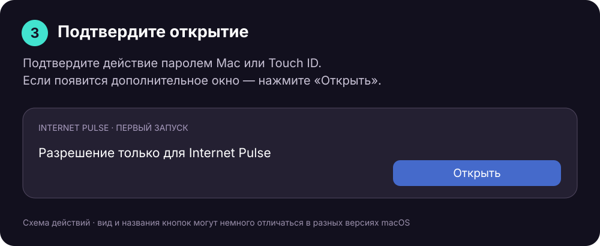

# Первый запуск Internet Pulse на Mac

Приложение не прошло нотариализацию Apple. Если macOS блокирует первый запуск из-за непроверенного разработчика, разрешение выдаётся для Internet Pulse отдельно.

Скачивайте сборку из [официальных релизов Internet Pulse](https://github.com/Ezhov777/InternetPulse/releases/latest).

## 1. Попробуйте открыть приложение

Распакуйте ZIP, перенесите `InternetPulse.app` в «Программы» и откройте двойным нажатием. Если macOS показывает предупреждение о непроверенном разработчике, закройте его кнопкой «Готово» или «ОК», сохранив приложение.

## 2. Разрешите запуск в настройках

Откройте ** → Системные настройки → Конфиденциальность и безопасность**. Прокрутите к разделу **«Безопасность»**. Найдите сообщение именно об **Internet Pulse** и нажмите **«Все равно открыть»**. В некоторых версиях macOS сначала отображается кнопка «Открыть».

## 3. Подтвердите действие

Введите пароль своей учётной записи Mac или используйте Touch ID, если система предложит. При дополнительном подтверждении выберите «Открыть». После этого приложение можно запускать обычным способом.

Если кнопки нет, повторите попытку открыть приложение и вернитесь в настройки: разрешение обычно доступно около часа после заблокированного запуска. На корпоративном Mac действие может ограничиваться администратором.

Картинки выше — поясняющие схемы, а не снимки реальных системных предупреждений. Для сообщения о найденном вредоносном ПО или повреждённой копии этот порядок не применяется: загрузите свежий архив и сообщите о проблеме.

[Инструкция Apple](https://support.apple.com/ru-ru/guide/mac-help/mh40617/mac)

## English

Extract the ZIP, move `InternetPulse.app` to Applications, and try opening it once. If macOS blocks this specific app because the developer is unverified, open **System Settings → Privacy & Security → Security**. Choose **Open Anyway** for Internet Pulse; macOS may show **Open** first. Authenticate with your Mac account when prompted, then confirm opening. If the button is missing, try launching again and return promptly; it is normally available for about an hour. The illustrations above are simplified guides, not system screenshots. This does not apply to malware or damaged-file alerts. [Apple guide](https://support.apple.com/en-euro/guide/mac-help/mh40617/27/mac/27).

## Français

Décompressez le ZIP, placez l’application dans Applications et essayez de l’ouvrir une fois. Si macOS bloque Internet Pulse en raison d’un développeur non vérifié : **Réglages Système → Confidentialité et sécurité → Sécurité → Ouvrir quand même**. Selon macOS, choisissez d’abord « Ouvrir ». Confirmez avec votre compte Mac. Si le bouton manque, recommencez l’ouverture ; il est généralement disponible environ une heure. Les images sont des schémas explicatifs. Cela ne concerne pas les alertes de logiciel malveillant ou de fichier endommagé. [Apple](https://support.apple.com/fr-fr/guide/mac-help/mh40617/mac).

## Deutsch

ZIP entpacken, die App nach Programme verschieben und einmal öffnen. Wenn macOS Internet Pulse wegen eines nicht überprüften Entwicklers blockiert: **Systemeinstellungen → Datenschutz & Sicherheit → Sicherheit → Dennoch öffnen**. Je nach macOS zuerst „Öffnen“ wählen. Mit dem Mac-Konto bestätigen. Fehlt die Schaltfläche, erneut öffnen und zeitnah zurückkehren; sie ist normalerweise etwa eine Stunde verfügbar. Die Bilder sind vereinfachte Erläuterungen. Dies gilt nicht für Malware- oder Beschädigungswarnungen. [Apple](https://support.apple.com/de-de/guide/mac-help/mh40617/mac).

## Español

Extrae el ZIP, mueve la app a Aplicaciones e intenta abrirla una vez. Si macOS bloquea Internet Pulse por un desarrollador no verificado: **Ajustes del Sistema → Privacidad y seguridad → Seguridad → Abrir igualmente**. Algunas versiones muestran primero «Abrir». Confirma con tu cuenta del Mac. Si falta el botón, vuelve a intentar abrir la app y regresa a los ajustes; suele estar disponible durante aproximadamente una hora. Las imágenes son esquemas explicativos. Esto no se aplica a avisos de software malicioso o archivos dañados. [Apple](https://support.apple.com/es-es/guide/mac-help/mh40617/mac).
