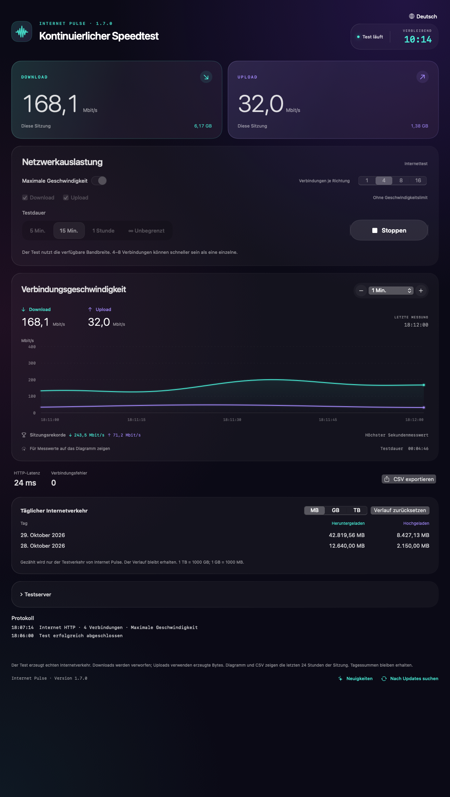
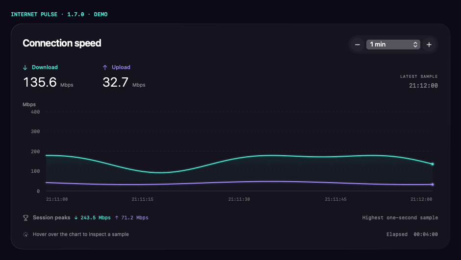

# Internet Pulse

**Kontinuierlicher Speedtest für macOS und Windows 11.** Prüfen Sie Ihre Internetverbindung unter längerer Last, begrenzen Sie Download und Upload und beobachten Sie parallele Verbindungen im Diagramm.

[Русский](../../README.md) · [English](README.en.md) · [Français](README.fr.md) · **Deutsch** · [Español](README.es.md)

**[Aktuelle Version herunterladen](https://github.com/Ezhov777/InternetPulse/releases/latest)** · Version 1.7.0 · MIT  
macOS 14+ / Apple Silicon · Windows 11 / x64

*Die Bilder zeigen die Anwendung mit simulierten Beispieldaten, keine echten Netzwerkmessungen.*

## Wozu dient die App?

Ein kurzer Speedtest liefert eine Momentaufnahme. Internet Pulse belastet die Verbindung minutenlang, eine Stunde oder unbegrenzt. Erkennen Sie Geschwindigkeitseinbrüche und vergleichen Sie WLAN mit Ethernet, verschiedene Räume oder die Leistung am Abend.

## Funktionen

- Gleichzeitiger oder getrennter Download und Upload, eigene HTTP-GET/PUT-Adressen.
- Maximale Geschwindigkeit oder getrennte Limits von 0,1 bis 20.000 Mbit/s.
- 1, 4, 8 oder 16 Verbindungen je Richtung; das Richtungslimit wird gemeinsam genutzt.
- Diagramm von 30 Sekunden bis 24 Stunden, Werte beim Zeigen und Sekundenrekorde.
- Tests über 5 Minuten, 15 Minuten, eine Stunde oder unbegrenzt; Countdown oder Laufzeit.
- Täglicher Datenverkehrsverlauf, Tausendertrennzeichen, MB/GB/TB und Zurücksetzen.
- Speicherung alle 10 Sekunden sowie beim Stoppen/Beenden. Bei einem Absturz können die letzten Sekunden verloren gehen.
- Suche nach Land und Anbieter; Kennzeichnung für nur Download oder beide Richtungen.
- Protokoll für Verbindungen, Fehler, Wiederholungen und Testergebnisse; Anzeige ohne Datenverkehr.
- CSV-Export, Versionsverlauf und manuelle Updateprüfung über GitHub.
- Russisch, Englisch, Französisch, Deutsch und Spanisch.

## Herunterladen und starten

Für macOS 14+ auf Apple Silicon laden Sie `InternetPulse-1.7.0-macos-arm64.zip`, entpacken das Archiv und verschieben `InternetPulse.app` nach Programme.

Für Windows 11 x64 laden Sie `InternetPulse-1.7.0-win11-x64.zip`, entpacken den gesamten Ordner und starten `InternetPulse.exe`. Alle Dateien müssen zusammenbleiben; die .NET-Laufzeit ist enthalten.

Schließen Sie die alte Version vor dem Ersetzen. Fertige Builds benötigen weder Xcode, Developer Tools, Visual Studio noch eine separate .NET-Installation. Der Mac-Build ist ad hoc signiert, ohne Apple-Notarisierung; der Windows-Build hat keine Authenticode-Signatur. Das System kann vor einem unbekannten Herausgeber warnen. Prüfsummen liegen im Release bei. Windows-CI prüft Netzwerkfunktionen und den WPF-Start; eine gesonderte manuelle Prüfung auf Windows 11 wurde nicht durchgeführt.

## Bedienung und Einheiten

Starten Sie im Maximalmodus mit 4 Verbindungen und vergleichen Sie 1 und 8. Mehr Verbindungen garantieren keine höhere Geschwindigkeit: Server, Anbieter, WLAN oder Computer können begrenzen.

Für kontrollierte Last deaktivieren Sie den Maximalmodus. **100 Mbit/s bei 4 Verbindungen bedeuten insgesamt etwa 100 Mbit/s je Richtung**, nicht 400. Kurze Spitzen sind möglich. Die vertikale Achse zeigt Mbit/s, die horizontale Zeit; 80 Mbit/s entsprechen etwa 10 MB/s.

Dezimale Einheiten: **1 TB = 1000 GB; 1 GB = 1000 MB**. Zahlen und Daten folgen der gewählten Sprache. Die Sprache wird über das Globusmenü oben rechts geändert.

## Daten und Grenzen

Gemessen werden HTTP-Nutzdaten der App, nicht der gesamte Systemverkehr oder Protokoll-Overhead. Downloads werden verworfen; Uploads enthalten erzeugte Bytes. Die HTTP-Latenz umfasst Verbindungsaufbau und erste Antwort, keinen ICMP-Ping oder Paketverlust.

Server sehen Ihre IP-Adresse. Es gibt keine integrierte Analyse und keine Übertragung des Verlaufs an den Entwickler. Updateprüfungen kontaktieren die öffentliche GitHub-API nur auf Anforderung; Updates werden manuell installiert. Einstellungen bleiben lokal: bestehende macOS-Einstellungskennung zur Migration, `%LOCALAPPDATA%\InternetPulse` unter Windows.

Verfügbarkeit und Leistung externer Server ändern sich. „Nur Download“ bedeutet, dass kein kompatibler HTTP-PUT-Endpunkt konfiguriert ist, auch wenn die Anbieterwebsite einen anderen Uploadtest anbietet.

## Entwicklung

Mac: `./scripts/test.sh`, `./scripts/test-network.sh`, `./scripts/package.sh`. Apple Command Line Tools werden nur zum Kompilieren benötigt.

Windows: .NET-10-SDK; `dotnet run --project Windows.Tests -c Release`, danach `dotnet publish Windows -c Release -r win-x64 --self-contained true -o dist/windows`. CI prüft auch den WPF-Start.

[Release-Anleitung](../RELEASING.md) · [Änderungen](../../CHANGELOG.md) · [Serverkatalog](../../servers.tsv) · [MIT](../../LICENSE)
