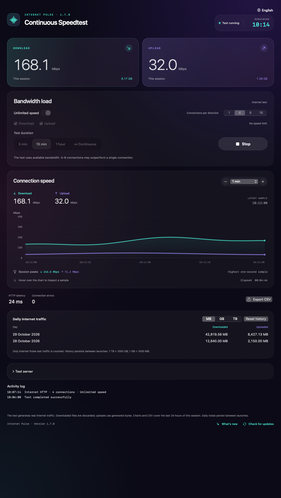

# Internet Pulse

**Continuous Speedtest for macOS and Windows 11.** Test sustained Internet load, set download and upload limits, use parallel connections and inspect the chart.

[Русский](../../README.md) · **English** · [Français](README.fr.md) · [Deutsch](README.de.md) · [Español](README.es.md)

**[Download the latest release](https://github.com/Ezhov777/InternetPulse/releases/latest)** · Version 1.7.0 · MIT  
macOS 14+ / Apple Silicon · Windows 11 / x64

*Screenshots show the application with synthetic demonstration data, not measured network results.*

Windows 11 interface

## Why use it?

A short speed test gives a momentary result. Internet Pulse keeps the connection busy for minutes, an hour or continuously. Spot speed drops, compare Wi-Fi with Ethernet and check different rooms or evening performance.

## Features

- Simultaneous or separate download/upload, custom HTTP GET/PUT endpoints.
- Maximum-speed mode or independent 0.1–20,000 Mbps limits.
- 1, 4, 8 or 16 connections per direction, sharing the direction’s total limit.
- Chart intervals from 30 seconds to 24 hours, hover values and one-second session peaks.
- 5-minute, 15-minute, 1-hour or continuous tests, with countdown or elapsed time.
- Daily traffic history, grouped numbers and MB/GB/TB units, plus history reset.
- History saved every 10 seconds and on stop/exit. An unexpected crash may lose the last few seconds.
- Country and provider search, with download-only and bidirectional labels.
- Connection/retry/error logs and final test outcome; no-data indication.
- CSV export, release history and manual GitHub update checks.
- Russian, English, French, German and Spanish interfaces.

## Download and run

[First launch on Mac: illustrated guide](../MAC_FIRST_LAUNCH.md#english).

Get `InternetPulse_1.7.0_macOS_arm64.zip` for Apple Silicon Macs running macOS 14 or newer. Unzip and move `InternetPulse.app` to Applications.

For Windows 11 x64, get `InternetPulse_1.7.0_Windows11_x64.zip`, extract the entire folder and run `InternetPulse.exe`. Keep its accompanying files together. The .NET runtime is included.

Close an older version before replacing it. Ready-made builds do not require Xcode, Developer Tools, Visual Studio or a separate .NET installation. The Mac build has an ad hoc signature without Apple notarization; the Windows build is not Authenticode-signed. Your OS may warn about an unknown publisher. Release assets include checksums. Automated Windows CI tests the engine and WPF startup; a separate hands-on Windows 11 check has not been performed.

## Usage and units

Start maximum-speed tests with 4 connections and compare 1 and 8. More connections do not guarantee better performance: the server, ISP, Wi-Fi or computer may be the bottleneck.

For a controlled load, disable maximum mode and set limits. **100 Mbps with 4 connections means approximately 100 Mbps total per direction**, not 400. Brief bursts are possible. The chart’s vertical axis is Mbps and its horizontal axis is time; 80 Mbps is approximately 10 MB/s.

Traffic uses decimal units: **1 TB = 1000 GB; 1 GB = 1000 MB**. Number/date formatting follows the selected language. Change language using the globe menu at the top right.

## Data and limitations

Measurements count application HTTP payload, not all system traffic or protocol overhead. Downloads are discarded; uploads contain generated bytes. HTTP latency includes connection setup and time to first response, rather than ICMP ping or packet loss.

Servers receive requests and see your IP address. No built-in analytics or history sharing. Update checks contact the public GitHub API only when requested; installation is manual. History/settings stay local; macOS preserves the legacy preference identifier for migration, while Windows stores data in `%LOCALAPPDATA%\InternetPulse`.

Third-party server availability and throughput vary by network and time. Download-only labels mean no compatible HTTP PUT endpoint is configured, even if the provider offers another upload test on its website.

## Development

For source downloaded from GitHub, first run `chmod +x build.sh scripts/*.sh`.

Mac: `./scripts/test.sh`, `./scripts/test-network.sh`, `./scripts/package.sh`. Apple Command Line Tools are needed only to build from source.

Windows: .NET 10 SDK; `dotnet run --project Windows.Tests -c Release`, then `dotnet publish Windows -c Release -r win-x64 --self-contained true -o dist/windows`. CI also tests WPF startup.

[Release guide](../RELEASING.md) · [Changelog](../../CHANGELOG.md) · [Server catalog](../../servers.tsv) · [MIT](../../LICENSE)
