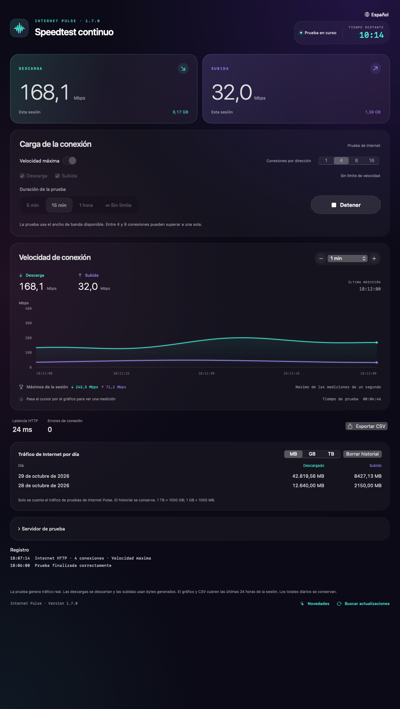

# Internet Pulse

**Speedtest continuo para macOS y Windows 11.** Prueba tu conexión con carga prolongada, limita la descarga y la subida, usa conexiones paralelas y observa el gráfico.

[Русский](../../README.md) · [English](README.en.md) · [Français](README.fr.md) · [Deutsch](README.de.md) · **Español**

**[Descargar la última versión](https://github.com/Ezhov777/InternetPulse/releases/latest)** · Versión 1.7.0 · MIT  
macOS 14+ / Apple Silicon · Windows 11 / x64

*Capturas de la aplicación con datos de demostración simulados, no resultados de mediciones reales.*

## ¿Para qué sirve?

Una prueba corta muestra un resultado puntual. Internet Pulse mantiene la carga durante minutos, una hora o sin límite. Detecta caídas de velocidad y compara Wi-Fi con Ethernet, distintas habitaciones o el rendimiento por la noche.

## Funciones

- Descarga y subida simultáneas o separadas; direcciones HTTP GET/PUT personalizadas.
- Velocidad máxima o límites independientes de 0,1 a 20.000 Mbps.
- 1, 4, 8 o 16 conexiones por dirección que comparten el límite total de esa dirección.
- Gráfico de 30 segundos a 24 horas, valores al pasar el cursor y máximos por segundo.
- Pruebas de 5 minutos, 15 minutos, una hora o sin límite; cuenta atrás o tiempo transcurrido.
- Historial diario, separadores de miles, unidades MB/GB/TB y borrado del historial.
- Guardado cada 10 segundos y al detenerse o salir. Un cierre inesperado puede perder los últimos segundos.
- Búsqueda por país y proveedor, con etiquetas de solo descarga o ambas direcciones.
- Registro de conexiones, errores, reintentos y resultado final; indicación de ausencia de datos.
- Exportación CSV, historial de versiones y búsqueda manual de actualizaciones en GitHub.
- Interfaces en ruso, inglés, francés, alemán y español.

## Descargar y ejecutar

Para macOS 14+ con Apple Silicon, descarga `InternetPulse-1.7.0-macos-arm64.zip`, descomprime y mueve `InternetPulse.app` a Aplicaciones.

Para Windows 11 x64, descarga `InternetPulse-1.7.0-win11-x64.zip`, extrae toda la carpeta y ejecuta `InternetPulse.exe`. Mantén juntos los archivos; se incluye el entorno .NET.

Cierra la versión anterior antes de sustituirla. Las aplicaciones preparadas no necesitan Xcode, Developer Tools, Visual Studio ni instalar .NET por separado. La versión Mac tiene firma ad hoc sin notarización de Apple; la de Windows no tiene firma Authenticode. El sistema puede avisar de un editor desconocido. La versión publicada incluye sumas de comprobación. La CI de Windows verifica el motor y el inicio de WPF; no se ha realizado una comprobación manual independiente en Windows 11.

## Uso y unidades

Empieza la prueba máxima con 4 conexiones y compara con 1 y 8. Más conexiones no garantizan mayor velocidad: el servidor, proveedor, Wi-Fi u ordenador pueden ser el límite.

Para una carga controlada, desactiva el modo máximo. **100 Mbps con 4 conexiones significa unos 100 Mbps totales por dirección**, no 400. Puede haber picos breves. El eje vertical muestra Mbps y el horizontal el tiempo; 80 Mbps equivalen aproximadamente a 10 MB/s.

Unidades decimales: **1 TB = 1000 GB; 1 GB = 1000 MB**. Los números y fechas siguen el idioma elegido. Cambia el idioma en el menú del globo de la esquina superior derecha.

## Datos y limitaciones

Se mide la carga útil HTTP de la aplicación, no todo el tráfico del sistema ni la sobrecarga de los protocolos. Las descargas se descartan; las subidas contienen bytes generados. La latencia HTTP incluye conexión y primera respuesta, no es ping ICMP ni medición de pérdida de paquetes.

Los servidores reciben solicitudes y ven tu IP. No hay analítica integrada ni envío del historial al desarrollador. La búsqueda de actualizaciones usa la API pública de GitHub solo cuando la solicitas; la instalación es manual. Los datos se guardan localmente: se conserva el identificador anterior de preferencias de macOS para migrar el historial; Windows usa `%LOCALAPPDATA%\InternetPulse`.

La disponibilidad y velocidad de los servidores externos varían. «Solo descarga» indica que no se ha configurado una dirección HTTP PUT compatible, aunque la web del proveedor ofrezca otra prueba de subida.

## Desarrollo

Mac: `./scripts/test.sh`, `./scripts/test-network.sh`, `./scripts/package.sh`. Apple Command Line Tools solo se necesitan para compilar.

Windows: SDK .NET 10; `dotnet run --project Windows.Tests -c Release` y después `dotnet publish Windows -c Release -r win-x64 --self-contained true -o dist/windows`. La CI también comprueba el inicio de WPF.

[Guía de publicación](../RELEASING.md) · [Cambios](../../CHANGELOG.md) · [Catálogo de servidores](../../servers.tsv) · [MIT](../../LICENSE)
