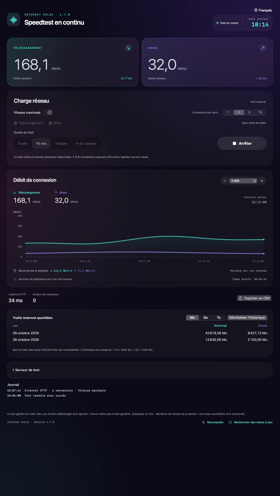

# Internet Pulse

**Speedtest en continu pour macOS et Windows 11.** Testez une charge Internet prolongée, réglez les débits de téléchargement et d’envoi, utilisez plusieurs connexions et observez le graphique.

[Русский](../../README.md) · [English](README.en.md) · **Français** · [Deutsch](README.de.md) · [Español](README.es.md)

**[Télécharger la dernière version](https://github.com/Ezhov777/InternetPulse/releases/latest)** · Version 1.7.0 · MIT  
macOS 14+ / Apple Silicon · Windows 11 / x64

*Captures de l’application avec des données de démonstration simulées, et non des mesures réelles.*

## À quoi sert-il ?

Un test bref donne un résultat ponctuel. Internet Pulse maintient la charge quelques minutes, une heure ou en continu. Repérez les baisses de débit, comparez Wi-Fi et Ethernet, différentes pièces ou les performances du soir.

## Fonctions

- Téléchargement et envoi simultanés ou séparés ; adresses HTTP GET/PUT personnalisées.
- Débit maximal ou limites indépendantes de 0,1 à 20 000 Mbit/s.
- 1, 4, 8 ou 16 connexions par sens, partageant la limite totale du sens.
- Graphique de 30 secondes à 24 heures, valeurs au survol et records sur une seconde.
- Tests de 5 minutes, 15 minutes, une heure ou sans limite ; compte à rebours ou temps écoulé.
- Historique quotidien, séparateurs de milliers, unités Mo/Go/To et réinitialisation.
- Enregistrement toutes les 10 secondes et à l’arrêt/fermeture ; un plantage peut faire perdre les dernières secondes.
- Recherche par pays et fournisseur, indication du téléchargement seul ou des deux sens.
- Journal des connexions, erreurs, reprises et résultats ; indication d’absence de données.
- Export CSV, historique des versions et recherche manuelle des mises à jour GitHub.
- Interfaces russe, anglaise, française, allemande et espagnole.

## Télécharger et lancer

Pour macOS 14+ sur Apple Silicon, prenez `InternetPulse-1.7.0-macos-arm64.zip`, décompressez-le et déplacez `InternetPulse.app` dans Applications.

Pour Windows 11 x64, prenez `InternetPulse-1.7.0-win11-x64.zip`, extrayez tout le dossier et lancez `InternetPulse.exe`. Gardez les fichiers ensemble ; l’environnement .NET est inclus.

Fermez l’ancienne version avant de la remplacer. Les applications prêtes à l’emploi ne nécessitent ni Xcode, ni Developer Tools, ni Visual Studio, ni installation séparée de .NET. La version Mac est signée ad hoc, sans notarisation Apple ; la version Windows n’a pas de signature Authenticode. Le système peut avertir que l’éditeur est inconnu. Des sommes de contrôle sont jointes au téléchargement. La CI Windows vérifie le moteur et l’ouverture de WPF ; aucune vérification manuelle distincte sur Windows 11 n’a été effectuée.

## Utilisation et unités

Commencez le débit maximal avec 4 connexions et comparez avec 1 et 8. Davantage de connexions ne garantit pas un meilleur débit : serveur, fournisseur d’accès, Wi-Fi ou ordinateur peuvent limiter le résultat.

Pour une charge contrôlée, désactivez le mode maximal. **100 Mbit/s avec 4 connexions signifie environ 100 Mbit/s au total par sens**, pas 400. Des pointes brèves sont possibles. Axe vertical : Mbit/s ; axe horizontal : temps. 80 Mbit/s correspondent à environ 10 Mo/s.

Unités décimales : **1 To = 1000 Go ; 1 Go = 1000 Mo**. Nombres et dates suivent la langue choisie. Le menu de langue avec le globe se trouve en haut à droite.

## Données et limites

Seule la charge utile HTTP de l’application est comptabilisée, pas tout le trafic du système ni les surcharges des protocoles. Les téléchargements sont ignorés ; l’envoi utilise des octets générés. La latence HTTP comprend connexion et première réponse ; ce n’est ni un ping ICMP ni une mesure des pertes.

Les serveurs voient votre adresse IP. Aucune analyse intégrée ni transmission de l’historique au développeur. La recherche de mises à jour contacte l’API publique GitHub uniquement sur demande ; l’installation est manuelle. Les données restent locales : ancien identifiant de préférences conservé sur Mac pour la migration, `%LOCALAPPDATA%\InternetPulse` sur Windows.

Disponibilité et débit des serveurs tiers varient. « Téléchargement seul » indique qu’aucune adresse HTTP PUT compatible n’est configurée, même si le site du fournisseur propose un autre test d’envoi.

## Développement

Mac : `./scripts/test.sh`, `./scripts/test-network.sh`, `./scripts/package.sh`. Les outils Apple Command Line Tools servent uniquement à compiler.

Windows : SDK .NET 10 ; `dotnet run --project Windows.Tests -c Release`, puis `dotnet publish Windows -c Release -r win-x64 --self-contained true -o dist/windows`. La CI vérifie aussi l’ouverture WPF.

[Guide de publication](../RELEASING.md) · [Historique](../../CHANGELOG.md) · [Serveurs](../../servers.tsv) · [MIT](../../LICENSE)
